# Kiến Trúc Tổng Thể Hệ Thống HospitalMS (Architecture Overview)

Hệ thống **Hospital Management System (HospitalMS)** được thiết kế và xây dựng theo mô hình **Microservices Monorepo**, tuân thủ nghiêm ngặt nguyên lý **Clean Architecture**, **CQRS (MediatR)**, **Domain-Driven Design (DDD)**, và cơ chế tích hợp hướng sự kiện (**Event-Driven Architecture**).

---

## 1. Sơ Đồ Kiến Trúc Tổng Thể (System Architecture Diagram)

```mermaid
flowchart TD
    subgraph Clients["Tầng Client & UI"]
        Browser["Trình duyệt Web (SPA)"]
        Mobile["Mobile Web / Tablet"]
    end

    subgraph Gateway["Tầng API Gateway & Security"]
        NginxGateway["Nginx / YARP Gateway\n(:5100)"]
    end

    subgraph Microservices["Tầng Dịch Vụ Microservices (Clean Architecture)"]
        IdentitySvc["IdentityService\n(:5101)\nAuth, RBAC, App Launcher"]
        PatientSvc["PatientService (MPI)\n(:5102)\nHồ sơ BN dùng chung, Merge"]
        CatalogSvc["CatalogService\n(:5103)\nICD-10, DVKT, Khoa phòng"]
        OutpatientSvc["OutpatientService\n(:5104)\nKhám ngoại trú, CLS, Viện phí"]
        InpatientSvc["InpatientService\n(:5105)\nNội trú, Sơ đồ giường, Y lệnh"]
        PharmacySvc["PharmacyService\n(:5106)\nKho dược, FEFO, Thẻ kho"]
        HealthExamSvc["HealthExamService\n(:5107)\nKhám đoàn, Trạm khám, Kết luận"]
    end

    subgraph EventAndCache["Tầng Tích Hợp & Cache"]
        RabbitMQ["RabbitMQ (Message Broker)\nOutbox + Retry + DLQ"]
        RedisCache["Redis (Distributed Cache)\nCatalog & Token Store"]
    end

    subgraph DataBases["Tầng CSDL (Database-per-Service)"]
        DB_Identity[(hospitalms_identity)]
        DB_Patient[(hospitalms_patient)]
        DB_Catalog[(hospitalms_catalog)]
        DB_Outpatient[(hospitalms_outpatient)]
        DB_Inpatient[(hospitalms_inpatient)]
        DB_Pharmacy[(hospitalms_pharmacy)]
        DB_HealthExam[(hospitalms_healthexam)]
    end

    subgraph Observability["Tầng Giám Sát & Logs"]
        SeqLogging["Seq Centralized Logs (:8081)"]
        MetricsOTel["OpenTelemetry & System Metrics"]
    end

    Browser --> NginxGateway
    Mobile --> NginxGateway

    NginxGateway --> IdentitySvc
    NginxGateway --> PatientSvc
    NginxGateway --> CatalogSvc
    NginxGateway --> OutpatientSvc
    NginxGateway --> InpatientSvc
    NginxGateway --> PharmacySvc
    NginxGateway --> HealthExamSvc

    IdentitySvc --> DB_Identity
    PatientSvc --> DB_Patient
    CatalogSvc --> DB_Catalog
    OutpatientSvc --> DB_Outpatient
    InpatientSvc --> DB_Inpatient
    PharmacySvc --> DB_Pharmacy
    HealthExamSvc --> DB_HealthExam

    PatientSvc -.-> RabbitMQ
    OutpatientSvc -.-> RabbitMQ
    InpatientSvc -.-> RabbitMQ
    PharmacySvc -.-> RabbitMQ
    HealthExamSvc -.-> RabbitMQ

    CatalogSvc --> RedisCache
    IdentitySvc --> RedisCache

    Microservices -.-> SeqLogging
    Microservices -.-> MetricsOTel
```

---

## 2. Các Mẫu Kiến Trúc Trọng Tâm (Core Architectural Patterns)

### 2.1 Clean Architecture 4 Lớp Cho Từng Dịch Vụ
Mỗi Microservice được tổ chức thành 4 projects độc lập theo thứ tự phụ thuộc nghiêm ngặt:
1. **Domain:** Chứa Aggregate Roots, Entities, Value Objects, Domain Events, Enums. Hoàn toàn độc lập với các thư viện bên ngoài.
2. **Application:** CQRS Commands, Queries, Request Handlers (MediatR), Validators (FluentValidation), DTOs, Behaviors (`ValidationBehavior`, `LoggingBehavior`, `AuditBehavior`).
3. **Infrastructure:** EF Core `DbContext`, cấu hình bảng (Fluent API), Repositories, Redis Cache implementation, MassTransit Event Bus, Migrations.
4. **API:** Controllers / Endpoints, JWT Authentication, Custom Exception Handler Middleware, Swagger / OpenAPI, Health Checks (`/health/live`, `/health/ready`).

### 2.2 Transactional Outbox Pattern & RabbitMQ Resilience
Để khắc phục bài toán phân tán dữ liệu và bảo đảm tính nhất quán (Eventual Consistency) mà không gặp rủi ro mất mát message khi network trục trặc:
- Thực hiện lưu trữ `OutboxMessage` cùng một transaction với thao tác ghi dữ liệu nghiệp vụ.
- `OutboxProcessorBackgroundService` định kỳ quét các message chưa gửi và chuyển tiếp vào RabbitMQ qua MassTransit.
- **Resilience Policy:** MassTransit được cấu hình Exponential Retry (3 lần: 1s, 3s, 7s). Sau khi hết số lần retry, thông điệp độc hại (poison message) sẽ tự động được chuyển sang hàng đợi **Dead-Letter Queue (`{queue}_error`)** để cách ly và xử lý thủ công.

### 2.3 Phân Quyền Theo Phạm Vi Khoa / Kho (Scope-based Authorization)
Bên cạnh cơ chế RBAC truyền thống (Role & Permission), hệ thống hỗ trợ cơ chế kiểm soát truy cập phạm vi sâu:
- **DepartmentScopeRequirement & Handler:** Kiểm tra người dùng có quyền thực hiện thao tác trên Khoa chỉ định thông qua claim `department` hoặc header `X-Department-Id`.
- **WarehouseScopeRequirement & Handler:** Kiểm tra quyền xuất/nhập/cấp phát thuốc trên Kho cụ thể qua claim `warehouse` hoặc header `X-Warehouse-Id`.
- Tài khoản quản trị viên (`Admin`) được tự động bypass kiểm tra phạm vi.

### 2.4 Quản Lý Concurrency & Kho Dược (FEFO + Stock Ledger)
- Sử dụng **Optimistic Concurrency** với token phiên bản (`Version`) trên từng lô tồn kho (`InventoryStock`).
- Áp dụng nguyên tắc **FEFO (First Expired, First Out)**: Tự động ưu tiên xuất các lô thuốc có hạn sử dụng gần nhất.
- Mỗi biến động nhập, xuất, chuyển kho đều bắt buộc sinh dòng ghi nhận vào **Sổ thẻ kho (`StockLedger`)** bất biến để phục vụ kiểm toán và thanh tra y tế.

### 2.5 Sơ Đồ Buồng Giường Nội Trú Kéo Thả Trực Quan
- Mô hình hóa buồng bệnh và giường bệnh theo 4 trạng thái tiêu chuẩn: `EMPTY` (Trống), `OCCUPIED` (Có người), `CLEANING` (Đang dọn vệ sinh), `MAINTENANCE` (Bảo trì).
- Hỗ trợ thao tác kéo thả (HTML5 Drag & Drop) trực tiếp bệnh nhân từ giường này sang giường khác hoặc chuyển khoa phòng tự động cập nhật trạng thái cơ sở dữ liệu.

